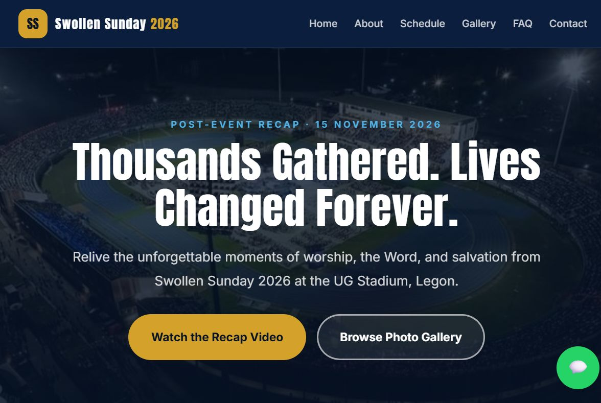
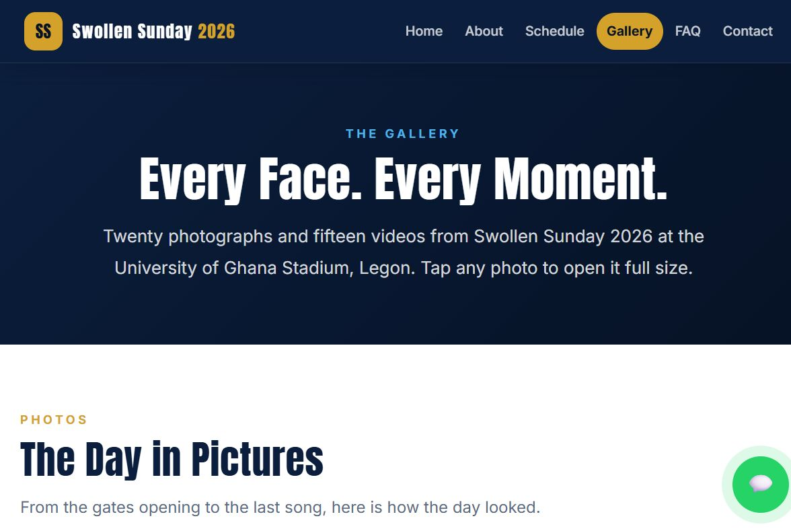

# Swollen Sunday 2026 — Post-Event Recap Website

A responsive, two-page recap of **Swollen Sunday 2026**, the annual mega-gathering of **First Love Church** at the **University of Ghana (UG) Stadium, Legon** — Sunday, 15 November 2026.

Built as a Level 200 web design project with **HTML5 and CSS3 only**: no frameworks, no libraries, no build tools, and no JavaScript beyond the single contact-form script supplied by the lecturer.

---

## What the site does

The event is over, but the story continues. The site gives visitors one place to:

- **Relive the day** through a crossfading photo hero and three recap videos.
- **See the proof** in a 20-photo gallery and 15 video clips.
- **Find answers** in a swipeable FAQ row built from the event's question cards.
- **Take the next step** with service times, a weekly programme, a map and a contact form.

| Page | What is on it |
|---|---|
| [`index.html`](index.html) | Hero, recap videos, about, pastors, gallery preview, event details, map, schedule, FAQs, contact form, footer |
| [`gallery.html`](gallery.html) | Page title, 20-photo grid, 15-video grid |

| Home | Gallery |
|:---:|:---:|
|  |  |

---

## Highlights

- **CSS-only hero slideshow** — four photos crossfade on a 24-second loop using one `@keyframes` rule and staggered delays.
- **Sticky navigation** that wraps neatly on phones instead of using a hamburger menu.
- **Hover life** — cards lift, photos zoom inside their frames, pastor captions slide in, buttons glow.
- **Horizontal FAQ row** with `overflow-x: auto` and `scroll-snap`, no JavaScript.
- **Soft grayscale map** that returns to colour on hover.
- **Event details and a four-card programme** with working Google Calendar links.
- **Accessible form** — labels tied to inputs, required fields and a visible focus ring.
- **Floating WhatsApp button** fixed to the bottom-right corner.

---

## Built with

| Layer | Choice |
|---|---|
| Markup | Semantic HTML5 (`header`, `nav`, `main`, `section`, `article`, `figure`, `figcaption`, `footer`) |
| Styling | One stylesheet: `css/style.css` |
| Layout | Flexbox and CSS Grid |
| Motion | `transition`, `transform` and four simple `@keyframes` animations |
| Responsive | Mobile-first, with breakpoints at **768px** and **1024px** |
| Fonts | Google Fonts — **Anton** for headings, **Inter** for body text |
| Scripts | Only `js/form.js` (lecturer-supplied) |

No frameworks, no package manager, no database.

---

## Project structure

```
swollen-sunday-website/
├── index.html                  home page
├── gallery.html                photos and videos
├── css/
│   └── style.css               the only stylesheet
├── js/
│   └── form.js                 contact-form script (placeholder)
├── images/                     30 photos used by the site
├── videos/                     16 clips
├── docs/
│   ├── CODE_EXPLANATION.md     beginner's guide to every section
│   ├── code_explanation.pdf    the same guide as a PDF
│   ├── Swollen_Sunday_Group_Presentation.pptx
│   ├── preview-home.jpg        README screenshots
│   ├── preview-gallery.jpg
│   ├── make_pdf.py             rebuilds the PDF
│   ├── make_pptx.py            rebuilds the slide deck
│   ├── make_faq_images.py      rebuilds the FAQ cards
│   ├── fonts/                  Anton, used by the image generator
│   └── faq-originals/          the ten original FAQ posters (archive)
├── LICENSE
└── README.md
```

---

## Run it locally

There is no build step. Either:

```bash
# Simplest: open the home page in a browser
start index.html          # Windows
open index.html           # macOS
```

or serve the folder (recommended for video seeking):

```bash
python -m http.server 8000
```

Then visit <http://localhost:8000>.

The Google Fonts, embedded map and calendar links need an internet connection. Everything else works offline.

---

## Customise it

### Colours

All five brand colours live at the top of `css/style.css`:

```css
:root {
  --primary: #0b1e3d;    /* deep navy */
  --secondary: #d4a12a;  /* gold */
  --accent: #4fb3e8;     /* sky blue */
  --light: #f4f7fc;      /* page wash */
  --dark: #061225;       /* footer */
}
```

Change a hex code once and every button, badge, heading and background follows.

### Text and media

Replace copy directly in the HTML. If a file name contains a space, write it as `%20` in the path (for example `images/Group%20pic.jpeg`).

A few placeholders are marked **[EDIT]** on purpose:

- Pastor captions in `index.html` — we never guess who is in a photograph.
- The email address in the contact section.
- Captions for some gallery photos and all 15 gallery videos.

### FAQ artwork

The ten supplied FAQ posters named a different venue and gave the start time as 2 PM. They were rebuilt in the site's navy and gold style with the correct venue (UG Stadium) and time (3:00 PM).

- New cards: `images/faq.jpeg`, `images/faq1.jpeg` … `images/faq9.jpeg`
- Original posters: `docs/faq-originals/`
- Regenerate: `python docs/make_faq_images.py`

### Remove the floating WhatsApp button

Delete the `<a class="whatsapp">` block at the end of the `<body>` in both HTML files, and the `.whatsapp` rule in `css/style.css`.

---

## Study materials

The `docs/` folder explains the build for beginners and for the presentation:

| File | Purpose |
|---|---|
| `CODE_EXPLANATION.md` | Every HTML section and CSS block, with a glossary and likely examiner questions |
| `code_explanation.pdf` | The same guide, formatted for printing (16 pages) |
| `Swollen_Sunday_Group_Presentation.pptx` | 17-slide deck with wireframes, speaker notes and a contribution table |

Rebuild the documents after editing:

```bash
python docs/make_pdf.py
python docs/make_pptx.py
```

---

## Responsive by design

| Feature | 360px | 768px | 1024px+ |
|---|---|---|---|
| Navigation | Two wrapped rows | One row | One row |
| Photo grid | 1 column | 2 columns | 4 columns |
| Video grid | 1 column | 2 columns | 3 columns |
| About / contact split | 1 column | 1 column | 2 columns |
| Schedule | 1 column | 1 column | 2 columns |
| Footer | 1 column | 2 columns | 4 columns |

Tested at 360px, 768px and 1280px: no horizontal scrolling, all media loads, and every menu link resolves.

### Accessibility

- `alt` text on every image.
- Labels tied to inputs with `for` and `id`.
- `aria-label` on the WhatsApp button and `title` on the map iframe.
- A visible focus ring on form fields.
- Correct heading order (`h1` → `h2` → `h3`) on both pages.

---

## The contact form

`js/form.js` currently contains only a comment. The lecturer's script will replace it and should:

1. Listen for `submit` on `#contact-form`.
2. Stop the page reload with `preventDefault()`.
3. Read the values by `name`: `fullname`, `phone`, `topic`, `message`.
4. Send them and show a thank-you message.

Until then the form validates with the browser's built-in `required` rules but does not send anything.

---

## Media and credits

- 30 photographs and 16 video clips were supplied by **First Love Church** for this recap.
- Event: Swollen Sunday 2026, University of Ghana Stadium, Legon.
- Hosts: **Dag Heward-Mills** and **Joshua Dag Heward-Mills**.
- Design and code: Level 200 group project, 2026.

The MIT licence below covers the **code**. The photographs and videos remain the property of First Love Church and are included for this event recap only.

---

## Team

Built by **Agyei Bortey Light Yaw Okatakyie** and team. Member roles and the contribution table are in the presentation deck (`docs/Swollen_Sunday_Group_Presentation.pptx`, slide 16).

---

## Licence

[MIT](LICENSE) © 2026 Agyei Bortey Light Yaw Okatakyie.
